# 陈硕 KAI

**AI 产品构建者 · 独立开发者 · 内容创作者**

我把创作和业务里反复出现的问题，做成可运行的产品、内容系统与 Agent 工作流。从需求、原型到上线，持续记录真实过程。

[个人网站](https://everlightai.top) · [X @ChenshuoAI](https://x.com/ChenshuoAI) · [全部公开项目](https://github.com/ChenShuo2004?tab=repositories)

## 代表项目

| 项目 | 解决什么问题 |
| --- | --- |
| [cs-board](https://github.com/ChenShuo2004/cs-board) | 把参考声音和中文文案生成白板动画视频的本地 AI 工具。 |
| [cs-skills](https://github.com/ChenShuo2004/cs-skills) | 将产品、内容、调研和交付流程沉淀为可复用的 Codex Skills。 |
| [CS 工作台](https://github.com/ChenShuo2004/cs-workbench) | Mac 桌面工作台，管理内容项目、素材、创作流程与交付记录。 |
| [Shuo's content OS](https://github.com/ChenShuo2004/Shuo-s-content-OS) | 把选题、创作、发布、预测与复盘连起来的内容操作系统。 |
| [XERJ](https://github.com/ChenShuo2004/xerj) | 面向 AI 搜索与 Agent 的代码和资料索引工具。 |

## AI 产品实验

- [紫微斗数](https://ziwei.aiyouwendu.com/) · [掼蛋记牌训练](https://guandanmaster.aiyouwendu.com/) · [冥想知识地图](https://meditation-knowledge-atlas.vercel.app/) · [关系复盘](https://lovetest.aiyouwendu.com/)
- [更多产品](https://aiyouwendu.com/products)

## 我在持续探索

- 把真实工作流程变成可复用的 AI 工具，而不止停留在 Demo。
- 用 Agent 和本地软件协作完成调研、内容创作与交付。
- 通过发布、用户反馈和复盘，检验产品假设。

如果你也在做 AI 产品、内容工具或 Agent 工作流，欢迎交流：[everlightai.top](https://everlightai.top)。

Idea → Build → Ship → Learn → Repeat

