# 陈硕 KAI

**AI 产品构建者 · 独立开发者 · 内容创作者**

我把创作和业务里反复出现的问题，做成可运行的产品、内容系统与 Agent 工作流。从需求、原型到上线，持续记录真实过程。

[个人网站](https://everlightai.top) · [X @ChenshuoAI](https://x.com/ChenshuoAI) · [全部公开项目](https://github.com/ChenShuo2004?tab=repositories)

## 代表项目

| 项目 | 我在做什么 | 可验证入口 |
| --- | --- | --- |
| [CS Skills](https://github.com/ChenShuo2004/cs-skills) | 把产品、内容、调研和交付方法做成可复用的 Agent 工作流。 | [安装与更新](https://github.com/ChenShuo2004/cs-skills#安装与更新) · [按目标选技能](https://github.com/ChenShuo2004/cs-skills#按目标选技能) |
| [CS Board](https://github.com/ChenShuo2004/cs-board) | 本地 AI 视频制作工作台：从文案与声音参考到动画和 MP4。 | [安装与运行](https://github.com/ChenShuo2004/cs-board#安装) · [示例成片](https://github.com/ChenShuo2004/cs-board/tree/main/examples) |
| [Shuo's content OS](https://github.com/ChenShuo2004/Shuo-s-content-OS) | 用命令行和模板连接选题、发布前预测与发布后复盘。 | [快速开始](https://github.com/ChenShuo2004/Shuo-s-content-OS#快速开始) · [隐私边界](https://github.com/ChenShuo2004/Shuo-s-content-OS#公开仓库安全边界) |
| [CS 工作台 Pro](https://github.com/ChenShuo2004/cs-workbench) | macOS 本地创作项目与交付管理。 | [源码与开发说明](https://github.com/ChenShuo2004/cs-workbench) · [公开下载](https://github.com/ChenShuo2004/cs-workbench/releases/tag/v0.1.0) |
| [XERJ](https://github.com/xerj-org/xerj) | 参与上游开源 AI 搜索与 MCP 项目的协作。 | [已合并贡献 #1469](https://github.com/xerj-org/xerj/pull/1469) |

## 从这里开始

- **想把常用工作流装进 Agent：** 从 [CS Skills](https://github.com/ChenShuo2004/cs-skills) 的安装说明开始。main 当前包含 25 个任务技能和 1 个执行辅助技能；完整发布包为 v0.7.0。
- **想看一个可运行的内容闭环：** 用 [Shuo's content OS](https://github.com/ChenShuo2004/Shuo-s-content-OS) 初始化私有工作区，再运行 status、new-script、predict、publish 和 retro 命令。
- **想看 AI 视频制作工具：** 查看 [CS Board 的安装要求和工作台截图](https://github.com/ChenShuo2004/cs-board#界面预览)，确认本机依赖后再启动。
- **想看桌面产品的真实发布状态：** CS 工作台 Pro 的 main 分支包含 0.7.0 源码；GitHub Release 目前仍是 v0.1.0。两者状态不同，按 [仓库说明](https://github.com/ChenShuo2004/cs-workbench) 查看对应下载与复现条件。

## 开源协作

我也参与上游项目的实际维护。2026 年 11 月，针对 [xerj-org/xerj#1469](https://github.com/xerj-org/xerj/pull/1469) 的改动已合并：将 CS Skills 作为非 live candidate 登记到 hub 草稿目录，并保留人工许可证审查等晋级条件。后续会继续通过 issue、review 和 PR 留下可核对的协作记录。

欢迎在 [CS Skills 的 Issues](https://github.com/ChenShuo2004/cs-skills/issues) 或其他项目的 issue tracker 交流、反馈和协作；也可以先浏览[全部公开项目](https://github.com/ChenShuo2004?tab=repositories)。

## AI 产品实验

- [紫微斗数](https://ziwei.aiyouwendu.com/) · [掼蛋记牌训练](https://guandanmaster.aiyouwendu.com/) · [冥想知识地图](https://meditation-knowledge-atlas.vercel.app/) · [关系复盘](https://lovetest.aiyouwendu.com/)
- [更多产品](https://aiyouwendu.com/products)

## 我在持续探索

- 把真实工作流程变成可复用的 AI 工具，而不止停留在 Demo。
- 用 Agent 和本地软件协作完成调研、内容创作与交付。
- 通过发布、用户反馈和复盘，检验产品假设。

如果你也在做 AI 产品、内容工具或 Agent 工作流，欢迎交流：[everlightai.top](https://everlightai.top)。

Idea → Build → Ship → Learn → Repeat

